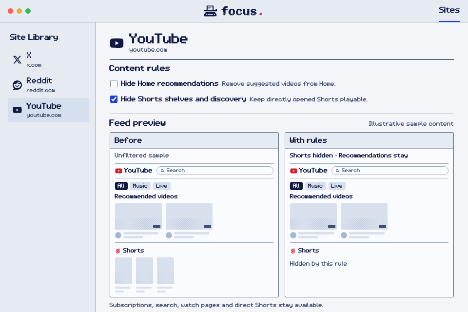
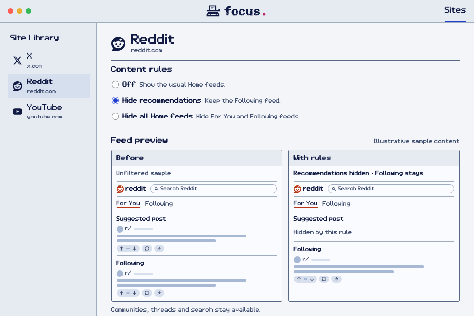

# Selective Feed Controls Implementation Plan

> **For agentic workers:** Use `executing-plans` and `test-driven-development` for each runtime checkpoint, `impeccable` for the approved Sites surface, and `verification-before-completion` for qualification. Commit the offline proof checkpoint first.

**Goal:** Let people remove distracting Home feeds without losing useful parts of X, Reddit or YouTube, and show the expected result before opening the site.

**Architecture:** The desktop owns revisioned choices in SQLite; the native session delivers supported snapshots to paired profiles. The extension applies locally packaged adapters only on exact granted origins. Sites renders offline illustrations, not live captures or application status.

**Tech stack:** Tauri 2, Rust/SQLite, Svelte 5, TypeScript, Vite and MV3.

**Spec:** The [approved standalone interaction proof](references/feed-preview-demo.html), stills below, and separate approved paired-browser action.

## Global constraints

- Start on `feature/content-slice-4a-selective-feeds` at `6174598815daa38e83bbfb8d3a19ef2a2967d52c` (tree `86bc9dd65b7590d3b77f8628b808efa43fbca7ca`). Leave calendar sync, other worktrees, Grace and local integration untouched. No merge or push by OMP.
- All new settings default off. Preserve saved Shorts preferences, current entry semantics and normal-build Pause/Block guards. Grace-phase enforcement and later slices are out of scope.
- Exact granted origin plus positive route and DOM evidence; unknown layouts stay usable. Package selectors locally and record their origin. Never track account data, credentials or private page content.

## Checkpoints

For each runtime checkpoint, write and observe a failing behavior test, implement the smallest passing change, rerun the affected tests, and commit separately.

1. **Persistence and protocol.** Add migration `008.sql` and a transactional, revision-checked `set_content_rules` command with a full typed site choice. Reject both modes of X or Reddit being enabled without changing any flags or revision. Allow both YouTube flags together and preserve `youtube.hide-shorts`. Add wire v5 and catalog validation in Rust and TypeScript. Older clients receive no disabled v5-only flags; retain the last supported snapshot and show Update required when the saved policy requires v5. Never acknowledge that revision on an older client. Acknowledge only after successful application on exact granted origins. Cover migration, stale revisions, invalid combinations and compatibility in core site-policy and protocol tests.
2. **X (`x.com`).** Off, Hide For you, Open Following instead. Hide only a positively identified For you timeline. Attempt the native Following tab once per Home visit or policy change; if that fails, hide only the recognized For you timeline. Protect Following, search, direct posts, replies, profiles, lists, messages and composing.
3. **Reddit (`www.reddit.com`).** Off, Hide recommendations, Hide all Home feeds. Preserve Following in recommendations-only mode and hide only identifiable modules in mixed Home; full mode hides both recognized Home feeds. Include populated Following. Protect communities, threads, comments, search, messages, `/r/all` and `/r/popular`.
4. **YouTube (`www.youtube.com`).** Independent Home recommendations and Shorts toggles. Preserve subscriptions, search, channels, watch player and controls, related videos and direct Shorts. Keep existing Shorts host support and preference. For all three adapters, exercise positive and adjacent protected cases, unknown layouts, late content and reused nodes, navigation, rule changes and grant loss; remove owned effects in open tabs.
5. **Sites desktop.** Place Before and With rules immediately under Content rules, side by side on desktop and stacked on narrow layouts. Reuse app tokens, bitmap faces and licensed marks. Retain native timeline cues for X; orange mark, search, communities and vote/comment controls for Reddit; red play mark, search, topic chips and landscape/portrait content for YouTube. Confine site colors to panes. Preserve the proof's labels, summaries, shapes and hints. Apply pending choices to With rules immediately; restore the latest saved choice on error. Before stays fixed. Only Browser access can report an applied revision. Use the brief stepped pulse for pointer changes; skip it for keyboard, reduced motion and toner pause. No skeleton busy semantics. Use solid fill and bold text for the selected row at rest, hover and press, including forced colors; no edge or inset shadow, and distinct focus. The demo's initial YouTube choice is illustrative only.
6. **Open in paired browser.** Separate action for eligible online v5 profiles, with profile choice when several qualify. Send a catalog destination, expected revision and short-lived one-time request ID through the authenticated selected profile's session. The extension rechecks exact grant and acknowledged revision, performs one top-level tab create, then reports success. Reject duplicates and stale requests; surface failure without automatic retries or arbitrary URLs. Cover multiple profiles, stale revision, expiry, duplicates, revoked access and disconnect in the packaged fixture.

## Adapter evidence

Exploratory Chrome for Testing 156 proof, not production qualification. X hid the observed For you timeline or selected native Following without hiding the composer; Following had no posts. Reddit hid 27 recognized items in the sampled For You view; recommendations-only retained the Following container and full mode hid it. Its empty Following account did not establish behavior with real Following posts or mixed layouts. YouTube observed 24 recommendations and two Shorts shelves, each independently cleared and both still cleared after more cards loaded. The sampled watch player and Pause control survived. A separate search pass preserved 19 regular results and the Shorts search tab while removing the sidebar shortcut. These observations do not qualify matched selectors across layouts or browsers, protected routes, protocol, fallback, paired profile opening or reversibility. Product previews are the approved illustrations, not live captures.

- X: [Adapter](../../../apps/extension/src/sites/x.ts) and [fixtures](../../../tests/sites/x.test.ts) use original, account-free selectors based on X Home observed for the proof. No third-party filter list or page content is bundled.
- Reddit: [Adapter](../../../apps/extension/src/sites/reddit.ts) uses original selectors from the observed Home layout. The [synthetic fixture](../../../tests/sites/reddit.test.ts) supplies populated Following and mixed Home that the exploratory account could not qualify.
- YouTube: [Adapter](../../../apps/extension/src/sites/youtube.ts) uses original Home card selectors from the observed desktop grid and preserves the existing original Shorts selectors. [Home fixtures](../../../tests/sites/youtube-home.test.ts) distinguish recommendations, subscriptions, protected routes and Shorts discovery.

## Candidate gate

- [ ] Run `npm ci`, `npm run check`, `npm run test:unit`, `npm run build --workspace @focus/desktop`, and `cargo test --locked --workspace` from `apps/desktop/src-tauri` for Cargo.
- [ ] Follow [Browser setup](../../browser-setup.md). Build the locked native fixture binaries and package once; run Linux `shared-rule`, `entry` and `selective-feed` on the same Chromium and Firefox archives. Retain reports, hashes and browser versions. Repeat representative cases in disposable live profiles where supported.
- [ ] Compare native Sites at 960×640, around 635px and at 200% across all six theme combinations. Check rollback, fixed Before pane, profile choice, selection at rest/hover/press, keyboard focus, toner pause, reduced motion, forced colors and offline operation. Separate native observations from browser emulation.
- [ ] Retain candidate/tree SHAs, red/green logs, commits, artifact hashes, captures and unresolved findings under `/private/tmp/focus-4a-omp-evidence`. Exit print mode to the tmux shell. Codex verifies the exact candidate and fast-forwards local integration only after passing gates; promotion or push requires separate authorization.

## Reference index

Original approved exports from `/private/tmp/focus-4a-site-preview`, copied byte for byte. These are documentation, not runtime assets.

| Reference | Source description | SHA-256 |
| --- | --- | --- |
| [feed-preview-demo.html](references/feed-preview-demo.html) | Self-contained interaction proof for the three illustrated site previews | `52107fea4d72af7a751e86f944af44ceb816b778400f79f161dc30ed2fcd3484` |
| [feed-preview-desktop.png](references/feed-preview-desktop.png) | Desktop YouTube preview comparison | `1d69286e9db0e78fa9563b3dfe3a4e568ce2533b0e045354c47a27de03cbf541` |
| [reddit-preview-desktop.png](references/reddit-preview-desktop.png) | Desktop Reddit preview comparison | `25e22d027e77ae023e2d8c4d8ab977e517ca236983ae8b67afc6c68c5bb03182` |
