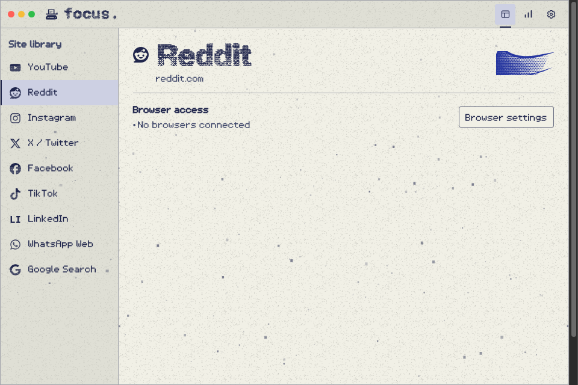

# Bring the bitmap interface into focus.

1. Base feature/dither-ui on dev. Preserve the existing native shell as the first commit. Prepare dev → stage → release CI separately. Configure hosted settings once a remote exists.
2. Use two isolated OMP sessions. Each starts on GPT-6.2 Astra with high reasoning and records a read-only prewalk, then switches to GPT-6.2 Sol for implementation. The UI session invokes using-superpowers, ask-matt, ui-ux-pro-max, and impeccable. The documentation session updates AGENTS.md on docs/dither-ui-guidelines.
3. Bundle regular and bold bitmap lettering for all app-owned text. Keep real selectable text, readable small glyphs, a local fallback, bold Site Library and stronger display lettering. Check Browser access, No browsers connected, and Browser settings explicitly.
4. Adapt the offset-carriage mark, align each site mark to its name with hostname below, and use an original neutral LI monogram. Keep the wide Sites curl and the Statistics empty-state illustration.
5. Add subtle paper grain and gently drifting, variably sized toner flakes to the canvas and library. Pause particles persistently. Respect reduced motion and forced colors. Reserve a single pointer-hover toner sweep for the wordmark and large site title.
6. Commit typography, shell identity and motion separately with passing focused tests. Integrate the documentation commit. Run the complete shell gate and inspect native rendering at 960×640, the 635px breakpoint and 200% zoom. Check keyboard interaction, window controls, all six theme/palette combinations, reduced motion and contrast. Capture native evidence before requesting review against dev.
