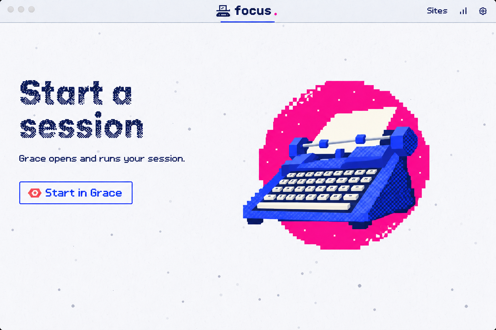
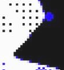
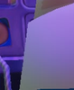

# Slice 3D.1–3D.3 Typewriter Implementation Plan

> **For agentic workers:** Use `executing-plans` to run only the authorized slice, then stop at its review gate. Checkboxes describe the order within each slice; they do not authorize later slices.

**Goal:** Replace the cropped Home illustration with a small, fully visible Cobalt typewriter that can be turned and played, without changing the Grace launch experience.

**Architecture:** Record the visual and keyboard contract first. Build and review an offline standalone viewer before mounting that same viewer and its matching still on Home. The viewer owns only artwork and its inputs; focus. still launches Grace, and Grace owns the session.

**Tech stack:** Svelte 5, TypeScript and Vite in the Tauri 2 shell; Blender/GLB export and provisionally a pinned, bundled Three.js renderer, subject to standalone review.

**Spec:** [Desktop design contract](../../../DESIGN.md) and [productivity roadmap](../../roadmap.md#productivity-slices). The [3D Grace-launch plan](3d-grace-launch-plan.md) records the completed launch path and its qualification limits.

## Global constraints

- One isolated feature branch and one OMP session per slice. Read the [OMP operating loop](omp-handoff.md#operating-loop-for-3a3f) before starting. Invoke `using-superpowers`, `ask-matt`, `using-agent-skills` and `writing-plans` in read-only prewalk; record the clean base and ordered todo. Use a real edit/write to enter implementation before any shell copy. Run OMP in Ghostty/tmux with GPT-6.2 Sol in both phases and retain log evidence.
- Use `brainstorming`, `impeccable` and `design` to evaluate the approved visual direction; ask the user before adding a new accent, mark or visual treatment. Use `algorithmic-art` for repeatable print effects, `test-driven-development` for runtime changes and `verification-before-completion` at every gate.
- Runtime assets and renderer must work locally, including first load offline. Track source, license, hashes and reproducible recipes. The reference images are documentation only: no reference pixels, generated legends, characters or watermarks ship in the viewer.
- Leave the toolbar typewriter logo, Grace action and native protocol, other views, browser policy and shared theme tokens unchanged. No schedules until 3E; focus. owns schedules and Grace owns sessions. 3F remains Glance Reading; original Slices 4–6 do not change.
- OMP commits the exact candidate, records checks, artifacts and blockers, then exits to the tmux shell. Codex confirms shell return and independently reviews that commit and the evidence before any local fast-forward. No slice author merges, pushes, promotes or starts the next slice. Repeat affected checks if the base moves.

## Approved visual target

The still approves the composition, not its generated key symbols or any change to UI text, marks or controls. Keep the [original Grace-launch dashboard](references/approved-cobalt-grace-launch.png) as the reference for the launch action, shell controls and history.

- Frame the whole small machine at a low front-right angle with a visible right sidewall and paper entering the roller. At 960×640, aim for an art field around 320 CSS px wide. The front of the machine overlaps the plate slightly. Keep the plate polygonal, nearly circular and slightly flattened, with vivid hot pink bounded to its silhouette. The typewriter alone floats vertically ±6 CSS px over a 6 s cycle, including during input; the plate stays fixed. Preserve the full silhouette through 360° of yaw, bounded pitch and float.
- Keep hard PS2-style facets and stepped raster edges on **both** machine and plate. Use ordered dithering for tone, visibly heavier halftone on the right sidewall and sparse dry toner. Keep Cobalt and hot pink vivid and bounded. Don't spread the art's raster or wear over text, controls, feed rows or the background. Keep the existing 3.6 s light paper hiss quiet and unchanged.

| Pixel stairs and halftone | Polygon facets | Coarse raster silhouette and lighting |
| --- | --- | --- |
|  |  |  |

The [reference index](references/README.md) records the provenance and SHA-256 of the four originals.

## Review focus

- A drag that starts or ends on a cap must not press it. A deliberate click or tap presses only the cap visible on pointerdown, even if the float moves it before release (3D.2 input tests).
- A correctly ordered atlas still fails if the camera mirrors it, UVs rotate it or a cap or pick target has the wrong ID (3D.2 front-on and per-key proof).
- Overlapping pauses must not restart the float until all pause reasons clear; paused art must not freeze the shell or disable intentional input (3D.2 motion tests, 3D.3 shell gate).
- Unavailable 3D must show the same scene rather than a blank or a misleading interactive image; illustrations off or forced colors must hide the scene entirely (3D.2 offline failure run, 3D.3 shell gate).
- Leaving Home must stop rendering and release input; returning or using the viewer must not affect native toolbar drag, focus order or the actual Grace action (3D.3 integration tests and native run).

## 3D.1 — Approved artwork and delivery contract

**Branch:** `feature/productivity-3d1-typewriter-contract`, from `f9c42403f8ff85ebc7cacdb39f9c5e8a989f8993` on `integration/productivity-desktop`, including the completed 3B static art and 3D Grace launch. Fetched `origin/dev` is already an ancestor.

- [ ] Record this plan, the approved composition and the later implementation gates. Link it from `AGENTS.md`, `DESIGN.md`, the roadmap, OMP handoff and reference index. Keep the original launch reference and the 3B export intact; reconcile any guidance that describes the earlier cropped still as the new target.
- [ ] Copy the four supplied files byte-for-byte into `references/` under descriptive names; embed them with accurate alt text, provenance and hashes. Do not touch application code, assets, dependencies or the Grace checkout.
- [ ] Commit locally. In a fresh checkout of the exact candidate, resolve changed docs' relative links and image embeds, fully decode the PNGs, and verify SHA-256 and byte equality against the originals. Preserve the output and candidate SHA for independent review. Stop before 3D.2.

## 3D.2 — Standalone interactive typewriter

**Branch:** `feature/productivity-3d2-interactive-typewriter`, from reviewed 3D.1 on `integration/productivity-desktop`. No Home, toolbar or Grace changes. Place the standalone Vite entry at `apps/desktop/typewriter-preview/index.html`; keep its reusable viewer, assets and focused tests in `apps/desktop/src/typewriter/`. Keep the offline export recipe and provenance with the [3B source and recipe](typewriter/README.md). The shell must not import the viewer in this slice.

- [ ] Inspect the [vendored Grab3D CC0 donor](typewriter/source/typewriter.glb) and its existing Blender recipe. Provisionally reuse the offline Three.js prototype at `/private/tmp/focus-typewriter-preview` (`viewer.js`, `page.html`, `typewriter-preview.html`) and the exporter `export-interaction-geometry.py` and GLB `typewriter-interaction-geometry.glb` in `/private/tmp/focus-grace-launch-omp-logs`. The scratch GLB has 39 separate cap nodes and a spacebar, not a verified keyboard map. Use these as starting material, not a dependency on `/private/tmp`; check in what is needed to rebuild, run and review the standalone candidate without the scratch directories. Record donor, export and atlas provenance, licenses and hashes; keep build tools out of the runtime.
- [ ] Specify the exact US QWERTY key map from the [Smith-Corona Silent Super portable manual](https://static1.squarespace.com/static/5ca223529d414920186973a5/t/63fe7b731701687e00ba3c84/1677622139965/Silent%2BSuper%2BManual%2BSmith%2BCorona%2B%281%29.pdf). The [Smithsonian Royal Portable Typewriter](https://www.si.edu/object/royal-portable-typewriter%3Anmah_1414421) is a separate physical reference for four rows and two Shift keys, not the source of the exact legends. Back to front: the number row with its punctuation, `QWERTYUIOP`, `ASDFGHJKL`, and `ZXCVBNM` with their punctuation. Two Shift caps flank the bottom letter row; the long separate spacebar sits in front. Stagger the rows, descend toward the viewer and expose all four from the resting camera. If the donor geometry hides a row or lacks a required cap, adapt the geometry to the map, not the map to the donor.
- [ ] Write failing tests for the exact map and scene bindings: one row/order entry per physical cap, one cap per ID, 26 letter legends each occurring once in order, distinct IDs for left and right Shift and spacebar, valid atlas entries and one-to-one pick/animation targets. Add failing input and motion tests for adjacent caps, drag versus press, keyboard scoping, reset, overlapping pause reasons and fallback/teardown. Run red with `npm run test:unit -- apps/desktop/src/typewriter`.
- [ ] Implement the local export and viewer. Check in the exact map with stable physical-key IDs, row and order, plain and shifted legends as applicable, and bind the same IDs to mesh, glyph atlas, picking and press animation. Generate and bundle the atlas from the local licensed [Focus Bitmap face](../../../packages/ui/src/assets/FocusBitmap-Regular.ttf); mount legends on their caps, upright from the operator's front, and keep them attached through orbit and press. Use the approved rest composition and print effects. Export a matching local still from the same scene and resting camera. On renderer, model or context failure, show the still without live controls.
- [ ] Use captured pointer/touch drag and focused arrow keys for unlimited horizontal orbit with bounded pitch. A full turn returns to the same angle, roll and framing; reset restores the approved camera. Latch the visible cap on pointerdown and actuate once on release within slop; crossing slop or cancellation never presses it. Keep input scoped so Tab, app shortcuts and scrolling outside the viewer remain usable. Keep bob running during hover, focus, held input and drag. Pause only for document hidden, viewer offscreen, reduced motion or toner pause. Keep the plate fixed, preserve deliberate input with motion off, and release resources on unmount.
- [ ] Run the focused tests green, `npm run check`, and the desktop build. Start with `npm run dev --workspace @focus/desktop` and verify `/typewriter-preview/` with external network blocked. Build the exact candidate as an offline HTML file. Capture rest at 960×640 and 390 CSS px, front-on keyboard and rear orbit proofs, and dated pointer and keyboard results for every ID. Record a full bob cycle during engagement and a real 360° drag with bob still running; verify exact wrap with reduced motion. Hand over the preview, fallback and pause results, candidate SHA, commands and evidence hashes.
- [ ] Show the live standalone preview and evidence to the user. Stop until the user explicitly approves it for Home and Codex independently reviews the candidate. A passing test suite, concept-still approval and local fast-forward are not approval to change Home.

## 3D.3 — Home-only integration

**Branch:** `feature/productivity-3d3-dashboard-typewriter`, from the reviewed 3D.2 integration head after explicit user approval of the standalone viewer. Consume the same viewer, map and still; do not reimplement them or change the approved treatment during integration.

- [ ] In `apps/desktop/src/App.test.ts`, add failing Home integration cases: art mounts only on Home with Print illustrations on; navigating or disabling art unmounts it; existing toner pause and hidden-window state reach the viewer without disabling **Start in Grace**. Run red with `npm run test:unit -- apps/desktop/src/App.test.ts`.
- [ ] In `apps/desktop/src/App.svelte`, replace only the Home hero art with the reviewed viewer. Pass existing illustration and pause behavior through to it; show the reviewed local still on unavailable 3D and hide all art under forced colors where supported. Preserve the native Grace command/action, toolbar logo and hit/drag regions, all six existing Light/Dark palettes, 3.6 s paper hiss, and all other views. Keep the art clear of copy, actions and feed rows through reflow and zoom. Run the targeted Home test green.
- [ ] Run the [project shell gate](../../../AGENTS.md#development-and-verification): `npm ci && npm run check && npm run test:unit`, `npm run build --workspace @focus/desktop`, `(cd apps/desktop/src-tauri && cargo test --locked --workspace)`, and `npm run tauri -- dev`. Inspect the actual native shell at 960×640, 635 CSS px and 200% zoom, including all six theme combinations, contrast and legibility, keyboard navigation and viewer input, native window controls and toolbar dragging, reduced motion, forced colors, persisted toner pause, illustrations off, unmount and unavailable-3D fallback. Separate native results from any browser emulation; report unsupported modes as such.
- [ ] With disposable data and the reviewed compatible Grace build, demonstrate that **Start in Grace** starts a real session even after interacting with the viewer and with the renderer unavailable. Record exact focus. and Grace SHAs, native launch result, captures/video, check output, artifact hashes and any limits. Commit locally and stop for independent review before any integration or 3E work.
