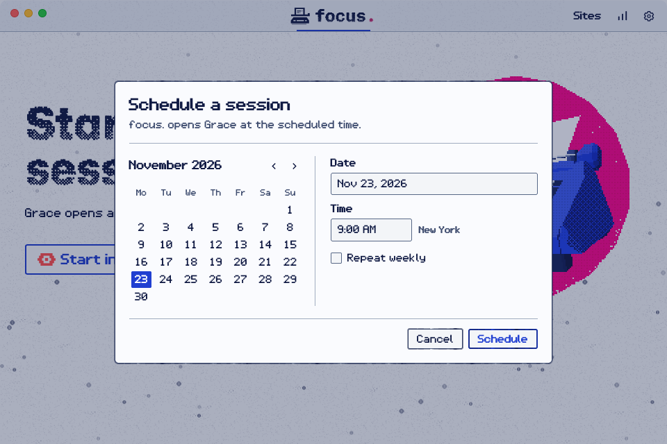
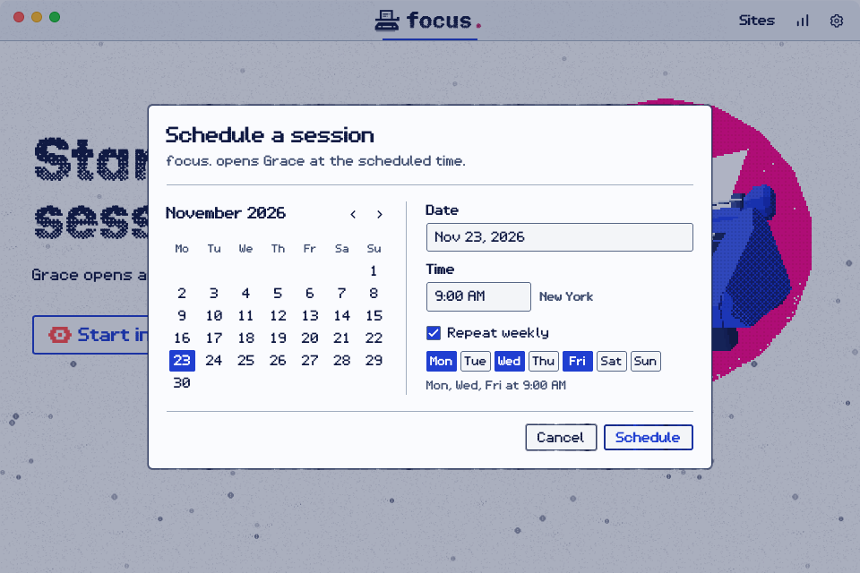

# Slice 3E — Schedule a Grace session from focus.

The user approved this implementation. Work only on feature/productivity-3e-grace-scheduling in /private/tmp/focus-productivity-3e. The verified clean 3D.3 base is 38c6321eaf38cc187ccae3796283c880f8bef8be (tree 46b47bf48fb6e96e34899920433ea93bee724d6d). After fetching origin, dev and origin/dev were both 3b047d1e08c67006db5563297429bdf0ce02dd6f and are ancestors of the base. The separately qualified Grace source is b624344fc3266eb15c9d32efb04486985e8edc43. See the [3D typewriter plan](3d-typewriter-plan.md) for the integration contract. The 3D.3 native review evidence is retained in the reviewer’s `focus-3d3-native` evidence directory (`REVIEW.md`). Keep the main workspace and Grace checkouts intact.

**Architecture:** focus-core owns local SQLite records and recurrence; the native desktop owns dispatch through the existing Grace launcher. Home edits schedules and displays native outcomes without owning session timing.

## OMP startup

Use Using Superpowers, Ask Matt and Using Agent Skills at entry. Apply Writing Plans to the portable handoff, Test-Driven Development to behavior, Impeccable and Design to the approved calendar, and Verification Before Completion to the candidate. Confirm worktree, branch and SHA. In prewalk keep everything read-only, inspect Home, dialog styles, focus-core migrations and the existing launcher, and produce the ordered task list. At the first edit let prewalk switch to GPT-6.2 Sol as configured. Capture the startup and first-edit model evidence from the session log.

## First commit — portable approved design

Track the complete handoff plan at docs/design/productivity/3e-scheduling-plan.md. Copy the two originals below under docs/design/productivity/references/ with their basenames. Embed the files from the plan with relative paths. Add provenance and SHA-256 to the illustrated reference index. Link the plan from docs/roadmap.md and the OMP handoff. Use a fresh checkout or tracked tree export to verify the embeds and bytes. The screenshots were rendered with the native Light Cobalt Home capture and bundled Focus Bitmap font. The user approved both. The dialog follows these PNGs, the earlier tracked Grace-launch mock governs the Home Schedules row, and merged 3D.3 governs the toolbar, live typewriter, Grace action and hiss. Escalate any further new visual treatment to Codex for user approval.

| Source file | SHA-256 |
| --- | --- |
| references/focus-3e-calendar-once-cobalt.png | 0997c2abf03deeac16118cf560496c8efa6c0472810d71d3e4faeb7d83bb4cfb |
| references/focus-3e-calendar-weekdays-cobalt.png | 8ca07d5045e79ebbc2a97066342c1c43ca3914cd9edf6045b2d72bef8b65e5f3 |

## Six implementation steps

1. **Persist schedules locally.** Write failing tests for saving one-off and selective weekday schedules, editing, deleting and reopening. Extend the existing focus-core SQLite migration chain. Store ID, first local date, wall-clock time, saved time zone, and optional weekdays. Upgrade a 3D.3 database copy and verify existing preferences, site policies and pairing. A fresh install has zero schedules. Expose desktop list, save and delete commands.
2. **Calculate occurrences.** Use deterministic Rust logic with an injectable clock. A one-off fires on the selected date. For repeat, use selected weekdays beginning on or after the first date, and display the first actual occurrence before save if that date is on an unselected day. Persist and display the selected time zone across travel. Skip nonexistent spring-forward wall times and use the first instant for doubled fall-back times. Test both transitions, month/year boundaries, edits and system-zone changes.
3. **Dispatch from native focus.** Run while the app is open or minimized regardless of view. Give each due occurrence a stable UUID and claim it durably in SQLite before dispatch. Invoke existing grace_launch::launch(app, occurrence_uuid, false) via its blocking-worker pattern. Serialize simultaneous due starts, skip overlaps, and skip elapsed starts at startup or wake. Preserve uncertainty and suppress automatic replay after an interrupted dispatch. Test repeated ticks, sleep, restart, simultaneous schedules, manual/scheduled races, and changes or deletion while a wake is pending. Grace uses its currently selected session and owns the timer, breaks, pause and end.
4. **Build the calendar.** Open Schedule a session from Schedules on Home. Follow the approved month grid, bitmap fonts, existing backdrop, theme tokens, thin rules and outlined controls. Month navigation and direct date/time entry must work and date/grid selection must stay in sync. Repeat weekly defaults off. Turning it on selects the chosen date's weekday initially and reveals the seven selector buttons and a plain-language summary. Require at least one weekday and a future occurrence. Keep validation near its field. Cancel and Escape discard and restore opener focus. Check keyboard operation, narrow widths, 200% zoom and accessible names.
5. **Manage schedules.** List upcoming entries chronologically with the next date and time and edit/remove access. Edits affect future occurrences. Completed one-offs leave upcoming. Keep failed one-offs accessible for recovery. Explain that focus. must remain running or minimized. Preserve the immediate Start in Grace action and keyboard access.
6. **Show truthful Grace outcomes.** Only a started acknowledgement confirms a start. Reuse busy, notApproved, missing, incompatible, unsupported, rejected and unconfirmed. Scheduled launches cannot request consent. For notApproved, direct people to use Start in Grace once for native confirmation. A busy session continues uninterrupted. Show an actionable failed result near its schedule. On unsupported platforms disclose availability before offering schedules that cannot run.

## Qualification and return

- Capture focused behavior tests failing before implementation and passing afterward. Run npm ci, npm run check, npm run test:unit, npm run build --workspace @focus/desktop, and cargo test --locked --workspace in apps/desktop/src-tauri. Include deterministic time changes, concurrent claims, and interrupted dispatch.
- Compare both native Light Cobalt dialog captures at 960×640 with the approved originals. Inspect at 635px, 200% zoom, and in all six palette/appearance combinations. Exercise keyboard date selection, focus visuals, Escape and opener focus restoration. Check reduced motion and forced colors with native and emulated evidence labeled accurately.
- Use the isolated macOS review setup and reviewed Grace artifact. Pair manually via the one-time native confirmation. Save a one-off via the actual calendar, stop Grace, minimize focus. and wait for the scheduled minute. Record real Grace opening, the expected profile, Pause, and two decreasing readings. Exercise a real selected-weekday launch and verify the next date. Verify busy does not reset the timer, unapproved does not prompt, closed/missed does not backfill, and edit/delete prevents the previous launch.
- Package focus. from the exact committed source. Interact with the typewriter and start a fresh real Grace session from Home by keyboard. Record both source SHAs, macOS version, bundle hashes, screenshots and launch observations.
- Commit focused changes. Report starting SHA, candidate SHA and tree, red/green logs, builds, native evidence and blockers, then exit to the tmux shell. Codex independently reviews the full diff and repeats the native minimized launch from the exact reviewed candidate. Codex alone fast-forwards the local integration branch after gates pass and verifies its tree. No push, promotion or next-slice branch.

3E covers local scheduling and Grace start. Preserve browser-policy guards and leave phase-aware policy coordination for separate qualification. 3F retains opt-in Glance Reading, user-added RSS, bundled or self-hosted support and upstream update/rollback. A future Glance calendar can display focus. schedules from the same records. Streaks require separate opt-in approval and verified Grace completion; an acknowledgement only confirms a start.

## Local scheduling behavior

Create, edit or remove schedules under **Schedules** on Home. The date and time are interpreted in the time zone shown in the dialog, even after the system changes zones. A weekly schedule may start later than its selected date if that weekday is not checked. Keep focus. open or minimized. Missed starts do not run the next time the app opens.

Only a Grace acknowledgement confirms a launch. If a scheduled start was not approved, use **Start in Grace** once to complete native confirmation. An unconfirmed start is not retried automatically; check Grace first, then edit the schedule if you want another attempt.
