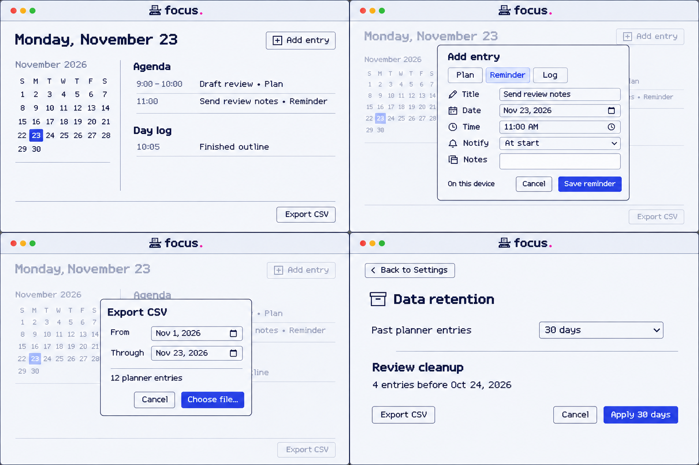
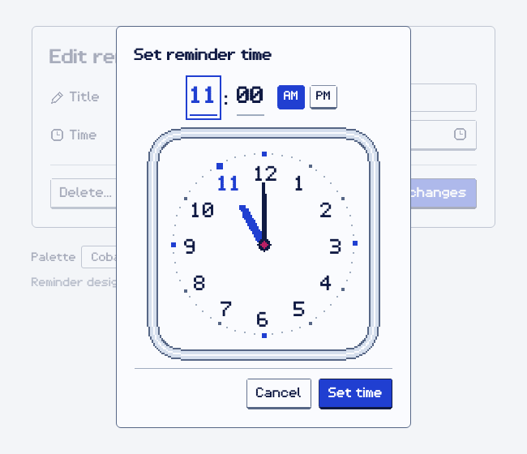

# Local Day Planner Implementation Plan

> Use Executing Plans and Test-Driven Development checkpoint by checkpoint. Use Impeccable to compare the running UI to the approved proofs and Verification Before Completion to qualify the exact candidate. Using Superpowers, Ask Matt and Using Agent Skills govern workflow discovery; Writing Plans governs this portable handoff.

**Goal:** Open a local agenda from Home to plan time, set reminders, log work and export planner data.

**Architecture:** Svelte owns presentation and drafts. Rust owns validation, SQLite, alerts, export and retention. Grace owns work sessions and keeps its existing editor and launch behavior.

**Stack:** Tauri 2, Svelte 5, TypeScript, Rust and SQLite. See [design contract](../../../DESIGN.md) and [roadmap](../../roadmap.md).

## References

| Reference | Provenance and SHA-256 | Authority |
| --- | --- | --- |
| [Four-screen proof](references/planner/agenda-editor-export-retention.png) | Codex generated image `01a20136-45e4-72e3-badd-8cd5fd86d8df/exec-f7afac8e-6c4b-41e0-b7b8-3c761e8ec70d.png`; `61227cad9099c002504aaa74c0c0bea643a2192d6f27e4002488972b305ebc87` | Agenda, boxed + Add entry, editor, export and separate Data retention page. Sample content is fixture data. |
| [Latest clock](references/planner/clock-top.png) | `focus-planner-action-proof/alarm-clock-top.png`; `9e68d28518af319b927da6408dd1156f66ab9d3aa7e0ebee27454480ca4a84cf` | Rounded pixel-stepped bezel, large bitmap numerals, two hands, square ticks and accent pivot. Editable time and AM/PM stay above the dial at every width. Colon box clears the visible ring on each side by at least 2 CSS px. |
| [Interactive clock](references/planner/clock.html) and [font notices](references/planner/THIRD_PARTY_NOTICES.md) | `focus-planner-action-proof/alarm-clock.html`; `750e181ae113a6329db8389b056d021e291a0756b2618a140cee69c040158255`. Notices: `1cde522d10d8fd9cf408142c205fc790cc4533f329c8d338de31bd00d4e2acb0`. | Dial interaction and tactile press; standalone offline proof. |
| [Hover research](planner-hover-research.md) | Original from integration, kept at the same relative path; `9c5bebcc0133b9d79646f72033376a0999b7e1261fbb4c26267658e219407f06` | Border tint is research only. Implement existing solid hover. |

Preserve bitmap fonts, compact pixel SVGs, flat paper and stepped edges. Scope tactile press to enabled planner controls: framed faces travel 2 CSS px over 55 ms and return over 180 ms; numerals move 1 CSS px. Keep hit bounds fixed, focus visible, travel suppressed in reduced motion and system colors in forced colors. Surface new visual decisions to Codex. No calendar sync, task spaces, Screen Time or streaks.

## Checkpoints

Run red then green tests, retain logs, and use focused commits. Commit this documentation and verify both embeds and the offline interactive HTML on the exact documentation tree before editing runtime code.

1. **Persistence and validation.** Add `006.sql` to the focus-core migration chain in `db.rs`. Store stable UUID, kind, title, optional notes, local date, wall-clock times, saved IANA zone and optional reminder lead. Plan has same-day start and later end; Reminder has event time and optional alert; Log has work time. Add typed list, save, delete and editor validation commands at the trusted main-webview boundary, retaining the origin check. Resolve using the saved zone, display mismatched device zone, reject spring-forward gaps beside the field and show the first fall-back offset before save. Test empty and populated 005 upgrades, preservation of schedules/site policies/preferences, moving entries, ranges, DST, travel and reopening.
2. **Agenda, editor and clock.** Open agenda from the Home calendar, merge Plan, Reminder and existing Rust-backed Grace occurrences by time and put completed work in Day log. Keep existing Grace editor and New schedule. Restore originating calendar focus on return. + Add entry defaults to Plan and the selected day. Use pencil/calendar/clock/bell alongside labels; require title; show field validation, refresh on save, confirm delete and discard drafts on Cancel/Escape with focus restoration. Share one time picker: hour advances to minutes, five-minute labels plus exact tick selection, editable Hour/Minute mode switching, AM/PM, semantic selection and marker. Set time applies; Cancel/Escape discard and restore focus. Test mixed agenda, all kinds, off-label minute, AM/PM, cancel, both input rings, press and single activation at control edges.
3. **Native reminders.** Offer At start, 5 minutes before, 15 minutes before, 1 hour before and No alert. Ask macOS permission on first alert save; schedule resolved instant once with identifier tied to UUID. Persist intent before registration and reconcile on restart and interrupted edits/deletes. Replace/cancel atomically at planner level. Retain entry and actionable status when denied, revoked or failed. For past alerts offer a future edit or No alert; explain alert availability on other platforms before save. Test duplicates, interruption, edit/delete, permission changes and elapsed alerts; OS acceptance is not delivery. Grace stays independent. [Apple local notifications](https://developer.apple.com/documentation/usernotifications/scheduling-a-notification-locally-from-your-app).
4. **CSV.** Inclusive local date range defaults to open day. Show count, then native Rust save picker in trusted main window. Atomically write UTF-8 CSV sorted by saved date, time and UUID. Header: type, local date, start, end, log time, time zone, title, notes, reminder setting; leave inapplicable cells empty. Neutralize formula prefixes in output without altering stored text. Test ranges, stable order, empty export, Unicode, multiline, commas, quotes, formula-like text, cancellation and write failure; parse independently. [Tauri save picker](https://v2.tauri.app/plugin/dialog/#save-files).
5. **Retention.** Direct Settings page, Back restores focus. Until I delete them (default), 30 days, 90 days and 1 year. Before shortening, show local-date cutoff, count and Export CSV. Recompute eligibility on confirmation and refresh changed previews. Commit preference and initial cleanup in one transaction. Reuse on startup and once per local day. Protect future entries, ongoing plans, pending reminders and Grace schedules. Test cancellation, stale preview, protected rows and SQLite page reuse.

## Candidate and review gate

Start `feature/productivity-local-day-planner` at `95f5d5ec404a593e0e002308d57451981b6f8100` (tree `ecbaa9fa2d9d53d5a2f30684b059f4c817c661b8`), same as local `integration/productivity-desktop`. Reviewed `dev`/`origin/dev` ancestor: `feb8594c1888186c0d15fb7988d192797a4d38c7`. Record clean prewalk in dedicated Ghostty/tmux pane and both GPT-6.2 Sol model events; preserve main, integration and Grace checkouts. No merging or pushing.

- [ ] From exact committed candidate, run `npm ci`, `npm run check`, `npm run test:unit`, `npm run build --workspace @focus/desktop` and `cargo test --locked --workspace` in `apps/desktop/src-tauri`. Package the exact tree; hash the bundle artifacts.
- [ ] With disposable data, compare native agenda, editor, clock, export and retention at 960×640, 635px, 390px and 200% zoom; verify six palettes, keyboard, both colon clearances, press/release, reduced motion and forced colors. Separate browser emulation from native evidence.
- [ ] Observe a real OS reminder after quitting focus.; qualify reschedule, cancellation, denial, revocation, sleep/wake and DST. Use the real export picker, parse its file and compare retention preview against exact removed and preserved rows.
- [ ] Use qualified Grace `b624344fc3266eb15c9d32efb04486985e8edc43` to prove manual and minimized scheduled starts with two decreasing timer readings. Saving a reminder must leave Grace idle. Reading opens and collapses on confirmed Grace start.
- [ ] Return base, candidate SHA/tree, commits, red/green logs, bundle hashes, native evidence and limitations in `/private/tmp/focus-day-planner-omp-evidence` and exit to the tmux shell. Keep independent gates moving if one is blocked. Codex owns independent review and local fast-forward.
