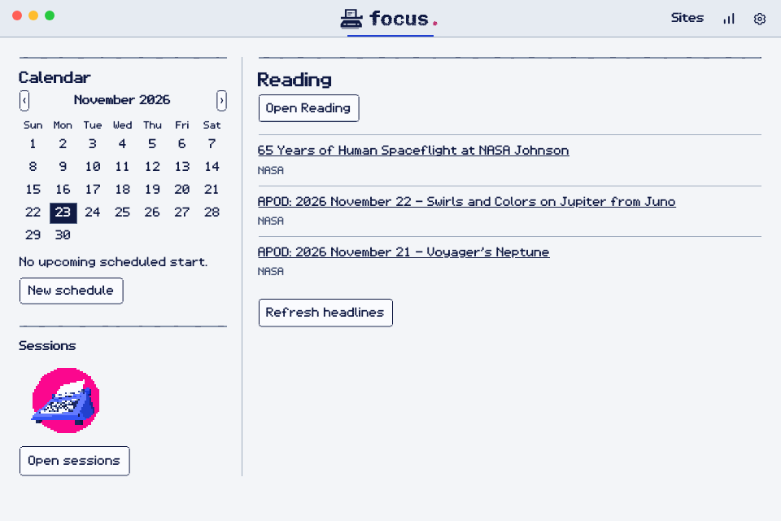

# PS1-inspired visual direction

The user approved this browser mockup as the future visual target. Slice 3F is merged locally at `0d3b72c3d730f97cfec203f6c3342ff60e22a168`. The visual refinement remains pending. [Dark study](references/ps1-dashboard-dark.png) · [Animated rules](references/ps1-header-motion.gif) · [Typewriter study](references/ps1-typewriter-study.png) · [Reference provenance and hashes](references/README.md#approved-ps1-inspired-direction).

## Visual and interaction contract

- Draw inspiration from PS1 low-resolution raster edges, polygon facets and bounded vivid colors. Keep the existing bitmap typography, uncluttered dashboard, established palette tokens and smooth solid paper on Home, Sessions and Settings.
- Use straight, thicker section rules above Calendar, Sessions and Reading. Subtle pixel clusters change in place in four held frames over 3.6 seconds, as shown in the motion proof. Keep line geometry and nearby text stationary. Keep headline separators quiet and thin. Honor saved toner pause, hidden-window state, reduced motion and forced colors.
- Use the mockup's small stepped corners on outlined buttons, continuously visible boundaries and opaque solid hover. The New schedule action has 4px vertical and 10px horizontal padding in the Light proof. Verify legibility, focus and adequate boundary contrast in each theme.
- Render the existing typewriter with faceted, low-resolution pixel edges and bounded cobalt shades over a single flat hot-pink polygonal disc without a shadow. Keep the approved camera, full rotation, weighted interaction, bob, individual pressable keys, readable literal bitmap legends and fallback. The still images illustrate direction; examine the live model before accepting it.
- Keep Settings headings' existing animated ink and solid hover. Keep text, controls and feed rows clear. Ask the user before adding any further accent, decorative mark or visual treatment.

## Pending slice and review

Cut one feature branch from the latest reviewed integration head. Use a fresh GPT-6.2 Sol OMP session in Ghostty/tmux with read-only `--prewalk`, following the [OMP handoff](omp-handoff.md). Invoke Using Superpowers, Ask Matt and Using Agent Skills at entry; use Impeccable and Design for visual comparison, Algorithmic Art for reproducible effects, Test-Driven Development for behavior and Verification Before Completion for the candidate. Commit focused changes early and return the exact candidate and evidence to Codex for independent review before local integration.

Compare the native Home with the tracked Light and Dark proofs at 960×640 and 100%, 635px reflow and 200% zoom. Inspect all six palette/appearance combinations, keyboard focus, solid hover, pause and resume, relaunch persistence, hidden windows, reduced motion and forced colors. Capture at least two complete rule-animation cycles. Inspect the interactive typewriter at multiple angles, including legible legends, key presses and the existing motion. Confirm immediate and scheduled Grace starts and Reading remain usable. Report native and browser-emulated results separately.

The local day planner, retention and CSV, calendar sync, task spaces and Screen Time continue in their recorded order and carry this design language when implemented. Their functionality and gates remain in the [3F follow-on scope](3f-glance-reading-plan.md#follow-on-scope-to-document-only).
