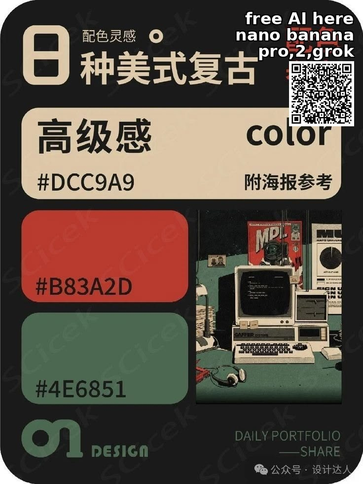
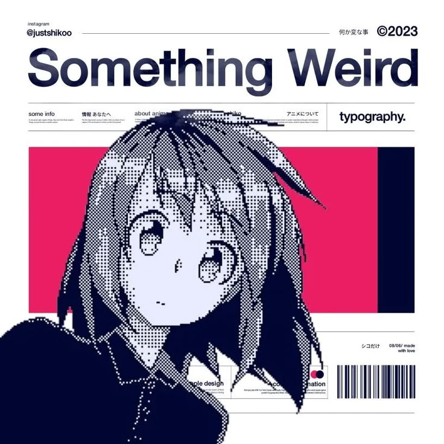
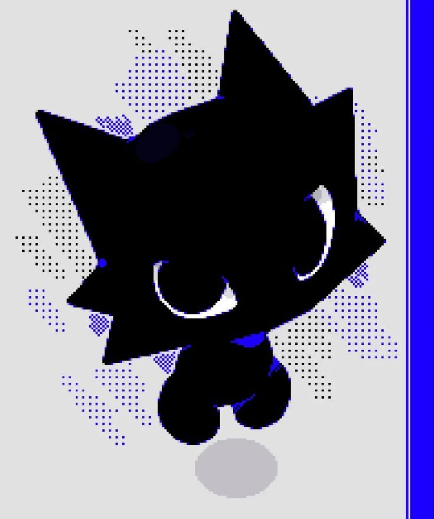

# Productivity art references

These eight user-supplied PNGs are unresized, byte-for-byte copies. Use them for art direction only. Keep their artwork, characters, watermarks and lettering out of the app. Read the [design contract](../../../../DESIGN.md) for how to apply these studies.

## Approved Light Cobalt dashboard

User-approved generated dashboard mockup. The camera sits low on the typewriter’s front-right side. Open cool paper holds the session name and timer; a hot pink field sits behind the Cobalt hero. This is the future dashboard target.

SHA-256 `2f6fec6f5e6d19baee4b71c94900b4e74633a1e04c5a0d22a0d6316b1230cb4a`

## Olive, khaki and espresso

Clipboard study with a visible 不二创艺 credit. Use the separation of bounded color surfaces as a reference.

SHA-256 `4d9aa07d6dfc5368dfc62c65103176c37e4585076a47929fdec8e946a804e16d`

## Olive poster and negative space

Clipboard poster credited in the image to Qinglan Design 2023. Use the large open shapes and the placement of heavy ink.

SHA-256 `cc916b092e92537196c8e875d219d5bb26c0851868523ed457dbe7a3b6d5f206`

## Wheat, brick and forest computer composition

Clipboard palette and retro computer study. Use the relatively small graphic area, hard composition edges and bounded color.

SHA-256 `e5d75d693f5b48b8d66358f9f1b46af560fbf5d6975eb84a533e18544a7872df`

## Three-ink palette

Clipboard palette with a visible Norvejski AI credit. The study uses `#DCC9A9`, `#B83A2D` and `#4E6851`; these values are not theme tokens.

SHA-256 `671f829827d060d87e2d979c01646661835b8c4890ea98f26d573f69fca7d22a`

## Hot pink and navy halftone poster

Clipboard poster titled *Something Weird*, with `@justshikoo` and ©2023 visible. Use its open paper, dense screened tone and sharply contained hot pink.

SHA-256 `4d742f55d85ffb7b5bc6288ff75f9b05a75bd240d76dd8552d55abb9de3b5f48`

## Cobalt silhouette and dot shadow

Clipboard cobalt silhouette study; original publisher unconfirmed. Use the hard silhouette and screened dot shadow as references for the typewriter’s ink treatment.

SHA-256 `d035e3385cc5727a181298adce48cee2550182add6b6e3ff0824e995012ee572`

## Cobalt crosshatching and halftone

Clipboard cobalt print study; original publisher unconfirmed. Use the difference between directional hatching and screened shadow to keep texture local to the art.

SHA-256 `111c6ca30b28733bb3249206c034db63636e40df07e71e2036f8bbceae5c30ca`
