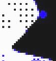
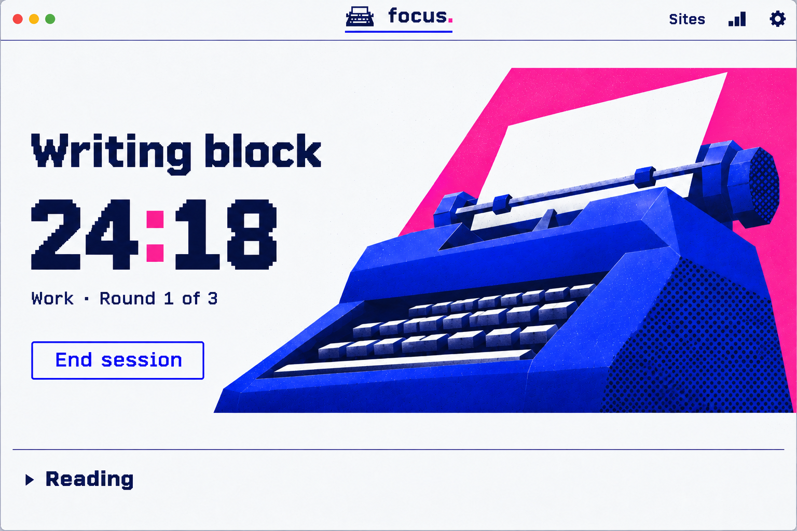
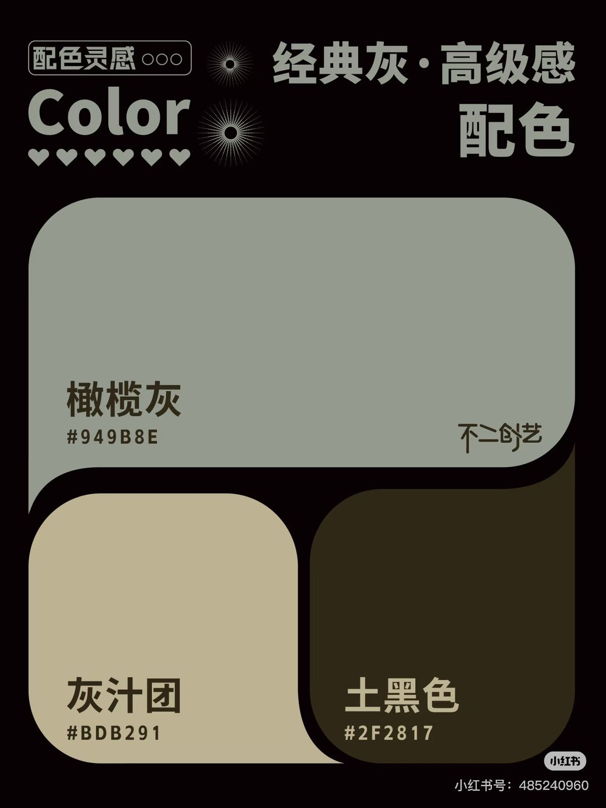
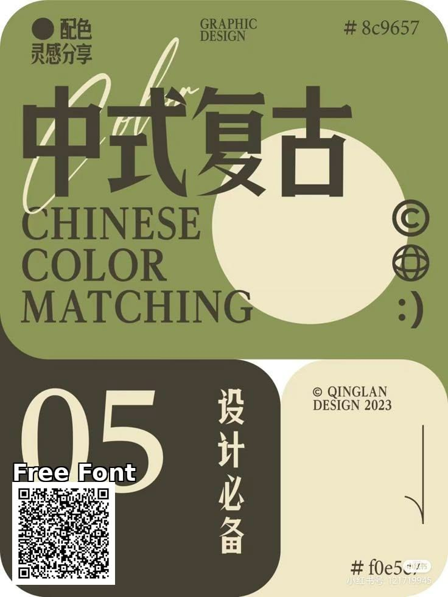
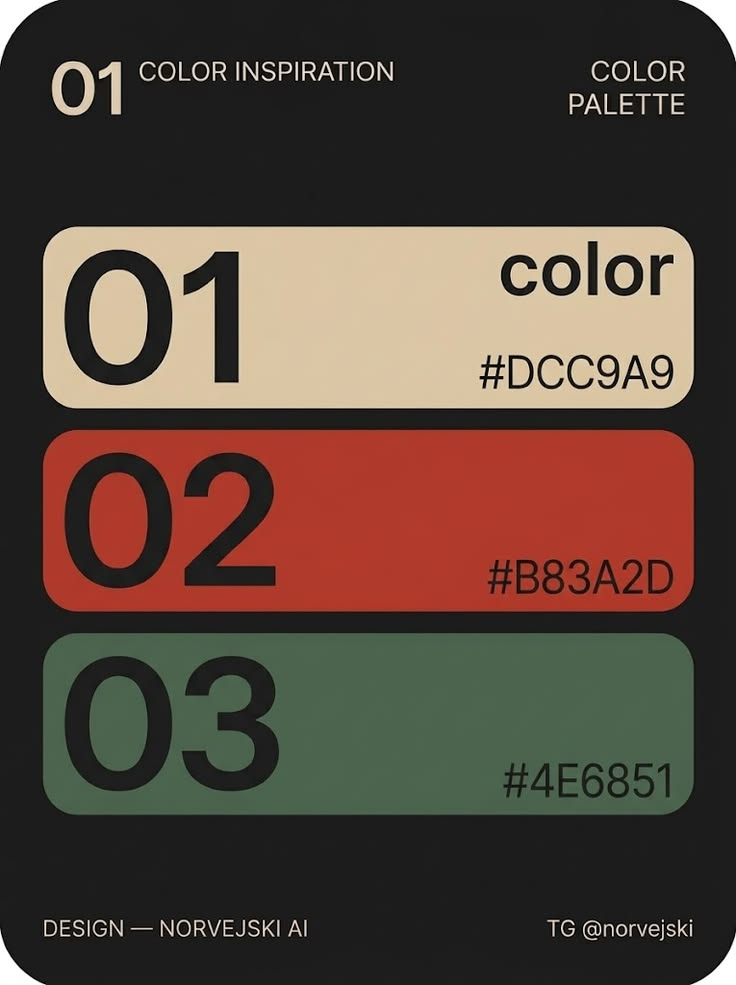
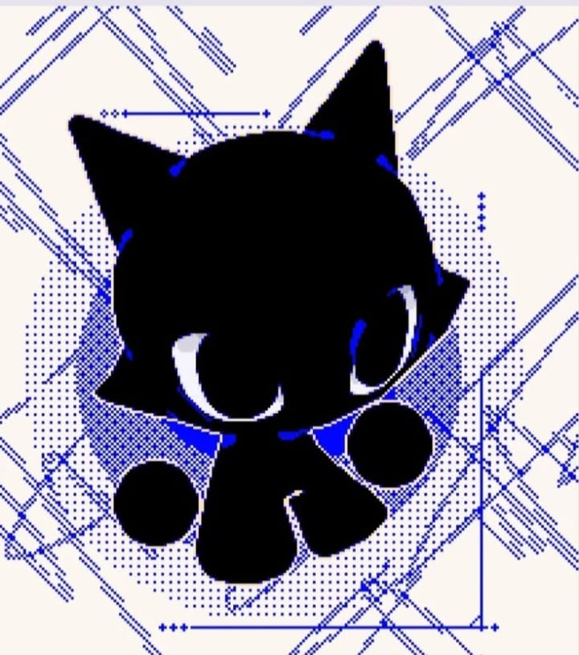

# Productivity art references

These PNGs are unresized, byte-for-byte copies supplied or approved by the user. Use them for art direction only. Keep their artwork, characters, watermarks and lettering out of the app. Read the [design contract](../../../../DESIGN.md) and the [illustrated 3D.1–3D.3 implementation plan](../3d-typewriter-plan.md) for where to apply these studies.

## Approved Light Cobalt floating typewriter

User-approved Codex-generated composition still (`exec-c940df98-0b93-45a3-89b2-122b35a632c0.png`). Use the small silhouette, front-right camera, visible sidewall, bounded plate and open stock. The generated key symbols are illustrative only; use the plan's real US QWERTY legends. The still does not replace the launch-controls reference below.

SHA-256 `3ee409ac05435523faceefd3e7babb1c3824bd498bd799b8c4e5660d6a133e45`

## PS2 study — pixel stairs and halftone

User-supplied clipboard crop (`2c1f073b-b86b-4d60-9c2a-41155290afb5`); original creator and publisher unconfirmed. Study the diagonal pixel stairs and dot pitch, not the depicted subject.

SHA-256 `a45bb98d5abd7d0f9f7a9b8d995bd2f70ca21baeec8e31e0b3e53e1965d0fac7`

## PS2 study — polygon facets

User-supplied clipboard crop (`6813d0a5-2085-4bc0-86bf-c0d825eb8173`); original creator and publisher unconfirmed. Study the broad angular planes and hard transitions between facets.

SHA-256 `37be4ab8b390221f4b9cd20fdae44e72fb3946e7555c74f2d9f8b1aa398a83a5`

## PS2 study — coarse raster silhouette and lighting

User-supplied clipboard crop (`a8794f8f-4515-4472-a8e8-e18fe0a2ec56`); original creator and publisher unconfirmed. Study coarse raster edges and separated lights and shadows. Do not reproduce the character or visible overlay marks.

SHA-256 `8cb0031d3d82ce70cfa7ff1f872fdcde6887104de0a00d12d13550d54cd63811`

## Approved Light Cobalt Grace-launch dashboard

Original user-approved 3D generated PNG (`exec-989997c4-bff0-4e41-841e-8d694dcf5b75.png`). Retain it for the launch controls and history, including the canonical Grace mark inside the action. The Schedules row is a 3E reference, not part of 3D. The floating typewriter still above supersedes only the cropped hero direction.

SHA-256 `7705da529e13321a9b189f1ee5a8e11d941680826c79ac614ffa3eea8c3cba44`

## Historical Light Cobalt timer comp

Earlier user-approved mockup. It records the low front-right camera and bounded pink field, but the session timer and controls are superseded by the Grace-launch dashboard.

SHA-256 `2f6fec6f5e6d19baee4b71c94900b4e74633a1e04c5a0d22a0d6316b1230cb4a`

## Olive, khaki and espresso

Clipboard study with a visible 不二创艺 credit. Use the separation of bounded color surfaces as a reference.

SHA-256 `4d9aa07d6dfc5368dfc62c65103176c37e4585076a47929fdec8e946a804e16d`

## Olive poster and negative space

Clipboard poster credited in the image to Qinglan Design 2023. Use the large open shapes and the placement of heavy ink.

SHA-256 `cc916b092e92537196c8e875d219d5bb26c0851868523ed457dbe7a3b6d5f206`

## Wheat, brick and forest computer composition

Clipboard palette and retro computer study. Use the relatively small graphic area, hard composition edges and bounded color.

SHA-256 `e5d75d693f5b48b8d66358f9f1b46af560fbf5d6975eb84a533e18544a7872df`

## Three-ink palette

Clipboard palette with a visible Norvejski AI credit. The study uses `#DCC9A9`, `#B83A2D` and `#4E6851`; these values are not theme tokens.

SHA-256 `671f829827d060d87e2d979c01646661835b8c4890ea98f26d573f69fca7d22a`

## Hot pink and navy halftone poster

Clipboard poster titled *Something Weird*, with `@justshikoo` and ©2023 visible. Use its open paper, dense screened tone and sharply contained hot pink.

SHA-256 `4d742f55d85ffb7b5bc6288ff75f9b05a75bd240d76dd8552d55abb9de3b5f48`

## Cobalt silhouette and dot shadow

Clipboard cobalt silhouette study; original publisher unconfirmed. Use the hard silhouette and screened dot shadow as references for the typewriter’s ink treatment.

SHA-256 `d035e3385cc5727a181298adce48cee2550182add6b6e3ff0824e995012ee572`

## Cobalt crosshatching and halftone

Clipboard cobalt print study; original publisher unconfirmed. Use the difference between directional hatching and screened shadow to keep texture local to the art.

SHA-256 `111c6ca30b28733bb3249206c034db63636e40df07e71e2036f8bbceae5c30ca`
