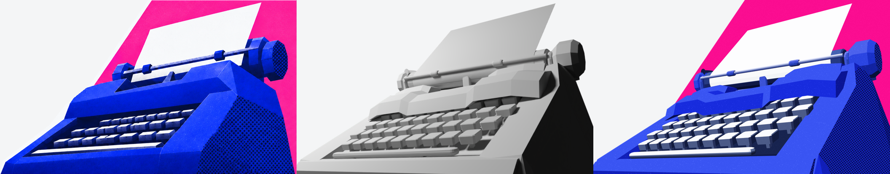

# Slice 3B — Cobalt typewriter

- [Static art](../../../../apps/desktop/src/assets/typewriter-cobalt.png) — 1408 × 832 RGBA PNG (2× for a 704 × 416 CSS-pixel field). The upper-left stock is transparent; the paper and bounded pink plate are part of the illustration. The bottom and right are intentional poster trims. No reference pixels, lettering, timer, or controls are in this file.
- [Clay](review/clay.png) — 704 × 416, transparent, without print effects. The clay and artwork use the same Blender scene geometry and camera.
- [Review strip at full scale](review/comparison.png) — approved-reference crop / clay / finished ink, left to right. Each panel is 704 × 416 at the reference's 960 × 640 desktop scale. The source comp is rescaled and only its overlapping text area is masked in the review strip; it is not used to render the artwork. View the strip at 100% to judge the key gaps and dot pitch.



The right platen knob sits nearest the camera and above the far knob in the image. The donor keyboard retains four staggered rows; the rear row tucks partly under the new hood, while the near caps and separate spacebar have real gaps. The white sheet wraps the platen and runs behind the bail. Flat cobalt facets and the navy screen carry the depth. The seeded dry-ink flecks sit on the printed areas rather than replacing the app's stock. The donor's proportions, four-row keyboard, and actual carriage parts differ from the simplified mockup; the crop is an adaptation, not a trace.

## Provenance

[Grab3D Typewriter](https://grab3d.com/models/electronics/typewriter/), by Grab3D (Germany), [CC0 1.0 Universal](https://creativecommons.org/publicdomain/zero/1.0/legalcode). The [upstream GLB](https://grab3d.com/dl/typewriter/typewriter.glb) is vendored byte-for-byte as [`source/typewriter.glb`](source/typewriter.glb); see the [manifest](https://grab3d.com/dl/typewriter/manifest.json) and [source license notice](source/LICENSE.txt), with line endings normalized. Grab3D describes the source as procedural with AI-assisted authoring code, not generated geometry or textures. No upstream scripts, `.blend` files, or foreign executables were used. The fallback model was not needed.

The [recipe](render.py) hash-checks the GLB before importing it. Blender welds and splits it into 95 original islands, including 39 distinct keys and a separate spacebar. The keys retain the donor's horizontal pitch; the recipe recasts the caps, outer shell, and knobs, reshapes and poses the paper and carriage, and discards the original PBR textures from the render. The new inks come from face-normal bands, a rotated screen on the near wall and knob face, and a seeded spot-color compositor. The source GLB plus this recipe is the editable source of record; no authoring tools are packaged with the app.

## Rebuild and verify

From the repository root. Qualification host: macOS 15.8.2 (24H232), arm64, CPU Cycles, Python 3.11.14, Blender Foundation `bpy` 4.5.4 LTS (`b3efe983cc58`), NumPy 1.26.4 and Pillow 11.3.0. The [official arm64 bpy wheel](https://pypi.org/project/bpy/4.5.4/#files) SHA-256 is `3e9dfbc05bef463591a4866e4abc25bcb34301912b67f4887a8dfc27ea871d17`. Dependency setup needs network once. Render and verification use only the checkout and the isolated environment afterward.

```sh
work=$(mktemp -d)
export UV_PYTHON_INSTALL_DIR="$work/python" UV_CACHE_DIR="$work/cache"
uv venv --python 3.11.14 "$work/venv"
uv pip install --python "$work/venv/bin/python" --index-url https://pypi.org/simple \
  --only-binary :all: bpy==4.5.4 numpy==1.26.4 Pillow==11.3.0
```

```sh
src=docs/design/productivity/typewriter
hero=apps/desktop/src/assets/typewriter-cobalt.png
py="$work/venv/bin/python"
"$py" -B "$src/render.py" "$work/export"
"$py" -B "$src/verify.py" "$work/export" "$work/export/typewriter-cobalt.png"
shasum -a 256 -c "$src/SHA256SUMS"
cmp "$work/export/typewriter-cobalt.png" "$hero"
cmp "$work/export/clay.png" "$src/review/clay.png"
cmp "$work/export/comparison.png" "$src/review/comparison.png"
```

The three PNGs reproduced byte for byte in a second render with network access denied on the qualification host. Other platforms and dependency versions were not qualified for identical bytes. The checker decodes all three PNGs and checks dimensions, open stock, the opaque white sheet, and coverage of the clay silhouette. The Blender recipe checks the imported island count and physical cap gaps. At the 3B gate the art was not referenced by the runtime; 3D later used the static hero on Home. This check does not qualify desktop UI or policy. See the [3D.1–3D.3 plan](../3d-typewriter-plan.md) for the later standalone viewer and Home review.

## Slice 3C — Sites inset

[The inset recipe](render-sites.py) downsamples the same CC0-derived picture to 264 × 156 for a 132 × 78 CSS-pixel print. Cobalt retains the original inks. Sage uses forest/brick and Plum uses plum/rust; both preserve the original screen, facets, pale sheet and alpha. Run `python -B docs/design/productivity/typewriter/render-sites.py` with Pillow 11.3.0 from the project root. These three local thumbnails do not change the 3B hero export.

## Author handoff

`feature/productivity-3b-typewriter-art` started clean with no tracking branch. Base `e75038b8e9fd98aab33de9d1eda28e72b9acb3c4` matched `integration/productivity-desktop` and contained fetched `origin/dev` at `3b047d1e08c67006db5563297429bdf0ce02dd6f`. No integration-base movement was needed.

OMP ran in Ghostty/tmux pane `%5`, in print mode with `--prewalk --model openai-codex/gpt-6.2-sol --prewalk-into openai-codex/gpt-6.2-sol`. The local session log in `/private/tmp/focus-productivity-3b-omp-logs` records the initial Sol model, the first `write` to `verify.py` after read-only planning at `03:58:23.805Z`, and the next assistant turn on Sol. No distinct model-change record was emitted for the same-model transition. Entry used Using Superpowers, Ask Matt and Using Agent Skills; Writing Plans tracked the gate; Brainstorming, Impeccable, Design and Algorithmic Art guided reference matching and the seeded print. Stop here for Codex's independent visual review; this is not approval to integrate or start the next slice.

## Slice 3D.2 — Standalone interactive preview

The [standalone entry](../../../../apps/desktop/typewriter-preview/index.html) loads the [reusable viewer](../../../../apps/desktop/src/typewriter/viewer.ts); the desktop shell does not import it. The viewer owns one canvas, exposes `reset()`, `setPaused(boolean)` and `destroy()`, and reports when the host should show the live canvas, matching static image, or no art. The host owns controls and persisted motion preferences. Use the same local still, aspect ratio (208:192) and canvas CSS for later integration, only after approval.

The ink is drawn at 208 × 192 with no antialiasing and displayed with nearest-neighbor scaling. The plate uses a stationary polygonal screen-space pass. The machine uses an independent perspective camera; its projection moves through the 6-second float while the same projection feeds cap picking. Housing and knob ink use ordered dot screening with sparse fixed dry marks; the opaque, chamfered caps use the Focus Bitmap Regular atlas without grain. The standalone uses the existing Light Cobalt stock color. Shell paper hiss, existing settings and Home layout are not part of this preview.

### Keyboard and sources

[Smith-Corona Silent Super portable manual](https://static1.squarespace.com/static/5ca223529d414920186973a5/t/63fe7b731701687e00ba3c84/1677622139965/Silent%2BSuper%2BManual%2BSmith%2BCorona%2B%281%29.pdf), p. 2 (© 1957 Smith-Corona Inc.), informs the four staggered rows, stacked legends, flanking Shift positions and separate blank spacebar. It is a physical reference, not an exact modern key layout: this preview uses contemporary US number/punctuation pairs so printed letters and punctuation match physical `KeyboardEvent.code` positions. No manual artwork is bundled.

[keyboard.json](../../../../apps/desktop/src/typewriter/keyboard.json) is the single map for the 46 physical IDs (`row`, left-to-right `slot`, plain and shifted `legend`, and physical `code`). [export-viewer.py](export-viewer.py) reuses the pinned CC0 donor and 3B recipe, moves the cover behind the number row, recasts the caps and near feet, and exports one independently pressable mesh per key. The same export paints the licensed local [Focus Bitmap Regular](../../../../packages/ui/src/assets/FocusBitmap-Regular.ttf) at integral bitmap cell sizes and writes the tile UVs on the cap tops, not on a separate overlay. The spacebar has a deliberately blank tile. Runtime dependencies: [Three.js 0.184.0](https://github.com/mrdoob/three.js/blob/r184/LICENSE) (MIT); its type definitions are development-only. See [viewer asset hashes](VIEWER-SHA256SUMS) and the [third-party notices](../../../../THIRD_PARTY_NOTICES.md).

### Rebuild and review offline

From the repository root, use the pinned Python environment above and Node 24 or later. Install dependencies and Playwright's Chromium once (or set `CHROME_PATH` to an installed compatible Chrome); authoring and first-load review need no remote assets. With a custom Chrome, `npm exec playwright install ffmpeg` installs Playwright's recorder if missing. System FFmpeg with libx264 is used only for the MP4.

```sh
npm ci
npm exec playwright install chromium
preview=apps/desktop/typewriter-preview
evidence="$(mktemp -d)"
"$py" -B docs/design/productivity/typewriter/export-viewer.py
npm run dev --workspace @focus/desktop   # keep running in a separate terminal
```

```sh
origin=http://localhost:1420
node "$preview/render.mjs" "$origin" "$evidence"
shasum -a 256 -c docs/design/productivity/typewriter/VIEWER-SHA256SUMS
node "$preview/build.mjs" "$evidence/viewer.html"
npm run test:unit -- apps/desktop/src/typewriter
npm run check
npm run build --workspace @focus/desktop
node "$preview/verify.mjs" "$evidence/viewer.html" "$evidence" "$origin"
node "$preview/record.mjs" "$evidence/viewer.html" "$evidence"
```

Open `viewer.html` directly, without a server. It contains the renderer, model, atlas, still, fonts and license notices. The Playwright verification opens both the offline file and the loopback preview with external traffic blocked, exercises actual pointer and keyboard bindings for every ID, touch cancellation, paused motion, view reset, WebGL failure and cleanup, and captures 960 × 640 and 390px screenshots. `render.mjs` uses the viewer renderer for the transparent resting still and an enlarged front-on keyboard proof. PNG byte identity is qualified on the recorded Chrome/SwiftShader version, not across drivers. Inspect both the full rest silhouette and every letter, Shift and punctuation pair in the keyboard proof before approving Home integration.
